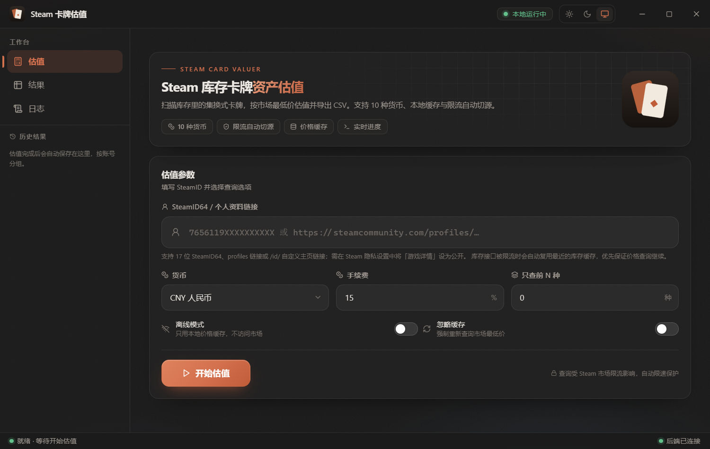
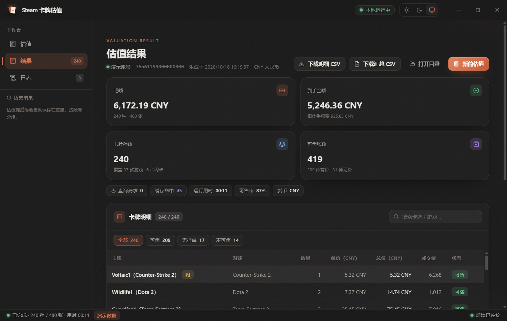

[简体中文](README.md) | **English**

# SteamCards

SteamCards is a desktop application for valuing the trading cards in a Steam inventory, built for Windows. The core logic — inventory reading, price lookup, cache management and CSV export — is implemented in Rust, the desktop shell is built with Tauri 2, and the interface uses React 19, TypeScript and Tailwind CSS.

## Features

- **Inventory reading**: Reads the public game inventory of a given Steam account and extracts tradable cards, foil cards and their quantities.
- **Price lookup**: Queries the Steam Community Market's exact price endpoint first; when rate limiting kicks in, it automatically falls back to the market search endpoint to fill in the remaining prices in bulk.
- **Local caching**: Caches prices, inventories and login cookies locally to reduce repeated requests, and reuses the last valid data when an endpoint is unavailable.
- **Result export**: Exports CSV files in both a per-card breakdown and a summary form.
- **History**: Stores past valuations per account, viewable and deletable inside the app.
- **Desktop experience**: Runs in its own window with no browser and no local service port; ships with light, dark and follow-system themes.
- **Interface language**: Switches between Chinese and English based on the operating system language.

## Screenshots

### Valuation form



### Valuation results



## Architecture

| Module | Stack | Responsibility |
| --- | --- | --- |
| Frontend | React 19, TypeScript, Vite, Tailwind CSS | Valuation form, progress display, result browsing, history and log views |
| Desktop shell | Tauri 2 | Window management, system dialogs, command bridge between frontend and backend |
| Core logic | Rust, Tokio, Serde | Steam API calls, price lookup and rate-limit handling, caching, CSV export, history |

## Repository layout

```text
web/                 React frontend source
server/              Rust core library and server
desktop/src-tauri/   Tauri desktop application shell
```

## Requirements

- Windows 10 or later
- Rust 1.75 or later
- Node.js 18 or later
- WebView2 Runtime (usually preinstalled on Windows 10/11)
- Tauri 2 build dependencies (on Windows the MSVC toolchain is recommended, together with the C++ Build Tools)

## Build and run

```powershell
# 1. Build the frontend
cd web
npm ci
npm run build

# 2. Run the core logic tests
cd ..\server
cargo test

# 3. Build the desktop app
cd ..\desktop
npx @tauri-apps/cli@^2 build
```

The desktop build reuses the frontend artifacts in `web/dist`, so the frontend must be built first. To build only the Rust server:

```powershell
cd server
cargo build --release
```

## Local data and privacy

Everything the app produces stays in the current user's profile and is never shipped with the source repository:

| Path | Contents |
| --- | --- |
| `%USERPROFILE%\.steamcards_cache.json` | Price cache |
| `%USERPROFILE%\.steamcards_inventory.json` | Inventory cache |
| `%USERPROFILE%\.steamcards_cookies` | Steam request cookies |
| `%USERPROFILE%\.steamcards_history` | Past valuation results |
| `SteamCards` folder in the user's Downloads directory | Exported CSV files |

This repository contains only source code and build configuration. It contains no Steam account, SteamID, inventory data, price cache, history results, CSV files or UI screenshots.

## Usage restrictions

- This tool is intended for personal inventory organization and learning purposes only. It offers no market trading, automated selling or account login.
- The Steam Community Market endpoints are rate limited. Keep query rates reasonable and avoid high-frequency or large-scale calls.
- This project is not affiliated with Valve Corporation or Steam.

## License

Released under the **GNU General Public License v3.0 (GPLv3)**, SPDX identifier `GPL-3.0-only`. See [LICENSE](LICENSE) for the full terms.
